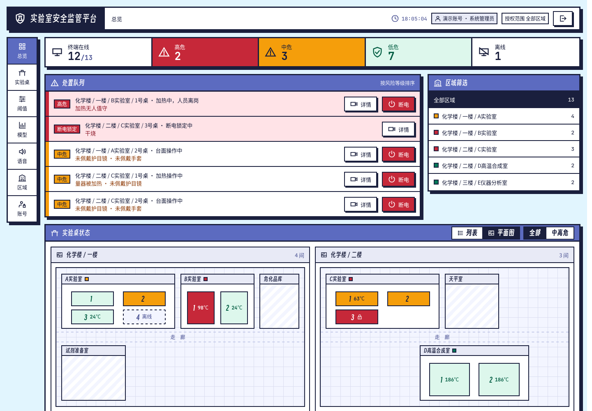

# LabGuard — Chemistry Lab Safety Monitor

**English** | [简体中文](README.zh-CN.md)

A dual-camera safety monitor for chemistry labs. It watches each lab bench with two cameras and a few sensors, warns **before** something goes wrong — heating left unattended, a beaker about to boil dry, missing goggles, smoke — and, when things become dangerous, cuts the heater power through a microcontroller. Restoring power is only possible on site, by long-pressing a physical key. Terminals from many labs report to a central **management console**, where staff browse by building, floor, room and bench.



| Bench touchscreen | Board-local web console |
| --- | --- |
|  |  |

> The UI text and in-repo documentation are in Chinese; this README and `README.zh-CN.md` are the bilingual entry points.

## Architecture

```
                 ┌──────── Management console (PC / server, port 8200) ────────┐
                 │ Accounts & grants · building/room/bench tree · floor plan    │
                 │ Threshold profiles · remote power-off · video & Q&A proxy    │
                 │ Model dashboard · voice packs · audit log                    │
                 └───────────────▲──────────────────────────────────────────────┘
                                 │ HTTP: report snapshot / fetch thresholds, commands, voice
                                 │ (the terminal keeps working if the console is offline)
 ┌──────── One board per bench (RK3588, Python) ────────────────┐
 │ 2 cameras + YOLO11 (NPU) → rules R1–R9 · cross-check · temp  │
 │ prediction · bench touchscreen · local web console (:8180)   │
 │ safety assistant (LLM)                                       │
 └───────────────▲──────────────────────────────────────────────┘
                 │ USB serial (AA 55 frames, CRC16): heartbeat, power-off, voice, climate control
 ┌──────── ESP32-S3 control box ────────────────────────────────┐
 │ SHT30 / MLX90614 / MQ-2 · relay · control key                │
 │ Local hard rules: ≥150 °C / smoke ≥2500 / no heartbeat 30 s  │
 │ → power off, independent of the board                        │
 └──────────────────────────────────────────────────────────────┘
```

## Features

**Bench terminal (single-board computer)**
- **Two-stream vision** — a panorama camera watches people (present or not, goggles / gloves / lab coat / mask, eating, sleeping at the bench); a desk camera watches glassware (type, proximity to the table edge). YOLO11, accelerated on the RK3588 NPU (~120 ms/frame).
- **Safety rules R1–R9** — dry burn, abnormal heating rate, heating unattended, smoke, high humidity, high ambient temperature, measuring vessel being heated, predicted dry burn.
- **Cross-check** — people × glassware × sensors combined into a low / medium / high risk score; every finding comes with a recommended action and drives the signal light and the touchscreen to-do list.
- **Tiered reporting** — one judgement, three views: student, lab teacher, building. Behavioural violations (e.g. eating with the mask off) are voiced to the student on the spot but only noted for the teacher; heating / temperature / smoke risks go to the teacher's disposal queue; the building level only sees power-off lockouts and critical events.
- **Desk safety zone** — draw the desk area and its dangerous edges in the web UI; glassware near or past a dangerous edge triggers a warning.
- **Temperature forecast** — below boiling it only predicts time-to-boil; if the temperature keeps rising past the boiling point it shows a dry-burn countdown. Advisory only — never cuts power.
- **Safety assistant** — writes handling advice for warnings and critical events, citing the safety manual. Three routes: remote LLM (Qwen via DashScope), local Ollama, or an offline rule template. The assistant is strictly read-only.

**Control box (ESP32-S3)**
- Acknowledges every power-off command; local hard limits and a 30 s heartbeat watchdog work even if the board crashes.
- **Control key, long-press 2 s** — while powered: cut power and lock; while cut: reset (temperature and smoke are re-checked first and the reset is refused if they are too high).
- Exhaust fan and humidifier run a local closed loop for temperature and humidity.

**Management console (multi-lab)**
- **Accounts & grants** — admin and teacher roles; teachers only see what they are granted (a building, a room or a single bench).
- **Overview** — disposal queue sorted by risk and shown per tier; benches switch between list and floor-plan views (floor → room → bench).
- **Bench detail** — both live streams (proxied), cross-check reasoning, safety Q&A, remote power-off (off only). When a terminal has no stream, an admin-uploaded demo image is shown and clearly labelled.
- **Threshold profiles** — rule thresholds pushed per area; terminals re-validate them against the control box's hard limits and report back any that were rejected.
- **Voice packs** — gentle / strict wording per alert type, played locally on the terminal.
- Model dashboard, audit log, optional legacy pixel style (per account).

## Repository layout

```
├─ labguard/     all code (run, config, firmware, deployment, tests)
├─ docs/         design documents, beginner guide, screenshots, dev notes
└─ slides/       presentation slides
```

```
labguard/
├─ run_app.py            bench terminal entry (board / PC)
├─ run_center.py         management console entry
├─ config.yaml           all thresholds and settings of the terminal
├─ environment.yml       conda environment (PC and board, recommended)
├─ requirements.txt      pip dependencies (without conda)
├─ src/
│   ├─ core/             safety core: rules, cross-check, desk zone, forecast, events, voice, console link
│   ├─ agent/            safety assistant
│   ├─ web/              board-local web console
│   ├─ ui/               bench touchscreen, desktop window
│   └─ hardware/         sensor data sources
├─ center/               management console: API, database, presets, web front end (vanilla JS, no build)
├─ LabSafetyMonitor/     camera + inference, serial protocol to the control box
├─ models/               detection models (.pt; *_rknn_model/ for the NPU)
├─ firmware/             ESP32-S3 control box firmware
├─ deploy/orangepi/      board install & autostart (AIOT-3588A, Orange Pi 5)
├─ knowledge/            safety manual used by the assistant
├─ fonts/                open-source fonts (Smiley Sans, JetBrains Mono)
├─ tools/                console demo, serial probe, NPU export/check, voice generation
└─ tests/                automated tests
```

## Quick start

Requires Python 3.10–3.12; conda is recommended.

```bash
cd labguard
conda env create -f environment.yml && conda activate lab_safety   # or: pip install -r requirements.txt
python run_app.py                          # desktop window + local web console (URL and token printed in the terminal)
python run_app.py --mode edge --windowed   # preview the bench touchscreen on a PC
```

Run modes: `--mode desktop` (default), `edge` (board: fullscreen touchscreen + web), `headless` (web only). The local console port is set in `config.yaml → web.port` (8180 here) and moves to the next free port if taken; the token is also stored in `runtime/web_token.txt`.

### Management console

```bash
python run_center.py                       # http://127.0.0.1:8200
```

The first start creates an `admin` account; its initial password is printed in the terminal and written to `runtime/center_initial_password.txt`. A password change is forced on first login.

**Connecting a terminal**: in the console's *Areas* page select a bench → register a terminal, copy the node key (shown once) into that board's `config.yaml`:

```yaml
center:
  url: http://<console-ip>:8200
  node_token: <the key you copied>     # or env var LABGUARD_NODE_TOKEN
```

Or create everything in one go (one bench, one terminal, one teacher account — no mock data):

```bash
python tools/center_init.py --center-url http://<console-ip>:8200 --password <teacher-password>
```

Restart the terminal and the bench shows as online. If the console goes down the terminal keeps judging and cutting power, and reconnects automatically.

### Demo without hardware

```bash
python tools/center_demo.py                         # http://127.0.0.1:8210, account demo / Demo2026show
python tools/center_demo.py --images <image-dir>    # set demo pictures per bench
python tools/center_demo.py --live LG-A01           # keep bench 1 for a real terminal, simulate the rest
```

The demo ships a three-floor sample layout and 13 simulated terminals (one offline). With `--live` it writes `runtime/center_demo_live.yaml`; start a real terminal with it:

```bash
LAB_SAFETY_CONFIG=runtime/center_demo_live.yaml python run_app.py --mode headless
```

Without cameras or a control box, the local console's *Parameters* page can play a demo video, and *Environment → Demo data* injects scenarios such as dry burn or smoke.

### Safety assistant with an LLM

The default route is remote → local → rule template. Without an LLM only the rule template is used (answers are tagged accordingly). To use Qwen on the board:

```bash
mkdir -p ~/.config/labguard && echo 'DASHSCOPE_API_KEY=your-key' > ~/.config/labguard/env && chmod 600 ~/.config/labguard/env
```

The autostart script `start.sh` loads this file; the key never enters the repository or any config file. On a PC just `export DASHSCOPE_API_KEY=...`. You can also run Ollama on a LAN machine and point `config.yaml → agent.local.base_url` at it.

## Deploying to the board

```bash
git clone https://github.com/SSSSSmilewei/lab-safety-monitor.git
cd lab-safety-monitor/labguard
bash deploy/orangepi/setup.sh          # system deps, serial/camera permissions, conda env, NPU runtime, autostart
python tools/check_npu.py              # NPU check: version, model load, speed, comparison with .pt
```

On boot, `deploy/orangepi/start.sh` starts the app: `edge` mode if a display is attached, otherwise `headless`. Logs: `runtime/app.log`.

## Flashing the control box

For an ESP32-S3-N8R8 with arduino-cli (esp32 core 3.3.12):

```bash
cd labguard
arduino-cli compile --fqbn esp32:esp32:esp32s3:FlashSize=8M,PartitionScheme=default_8MB,PSRAM=opi,CDCOnBoot=default \
    --output-dir firmware/build_s3_n8r8 firmware/lab_guard_esp32
arduino-cli upload --fqbn esp32:esp32:esp32s3:FlashSize=8M,PartitionScheme=default_8MB,PSRAM=opi,CDCOnBoot=default \
    -p /dev/ttyACM0 --input-dir firmware/build_s3_n8r8 firmware/lab_guard_esp32
```

Relay / buzzer / key active levels are set by `RELAY_ACTIVE_HIGH` / `BUZZER_ACTIVE_HIGH` / `BTN_ACTIVE_HIGH` at the top of the firmware. Serial debugging: `python tools/serial_probe.py`.

## Tests

```bash
cd labguard
python tests/test_backend.py    # 87 checks: safety core, rules, serial protocol (simulated MCU), control key
python tests/test_platform.py   # 44 checks: local console API, assistant, safety-constraint checks
python tests/test_center.py     # 81 checks: console, mixed grants, terminal over real HTTP, floor plan, tiers, teacher call
```

No hardware or LLM needed; tests use a temporary database and never touch `runtime/`.

## Safety design principles

- **Software can only cut power, never restore it.** Neither the local console nor the management console exposes a power-on / unlock endpoint; power returns only by a long press on site, after the control box re-checks temperature and smoke. Tests inspect the route list.
- **The LLM never touches the relay.** All assistant tools are read-only; the forecast only advises.
- **Control-box rules run independently of the board** as the last line of defence; web-configured thresholds can only be set below the box's hard limits.
- **Demo data never mixes with real data**: once a control box is connected, demo injection is refused; demo images in the console are clearly labelled.
- **API keys live in environment variables only** — not in config files, not in the repository.

## Documentation

- [Beginner guide](docs/零基础上手指南.md) (Chinese) — step-by-step introduction with screenshots and flow charts
- [AGENTS.md](AGENTS.md) (Chinese) — project notes for AI assistants: interfaces, protocol, pins, current status. Ask your AI assistant to read it first
- [Dev notes](docs/开发记录/) (Chinese) — code review, change plan with bill of materials
- Design documents (docx / pdf) are under `docs/`

## Versions

| Tag / branch | Content |
|---|---|
| `v1-prototype` | the original prototype |
| `v2-before-restructure` | full version before the directory restructure |
| `main` | current: bench terminal + control box + multi-lab management console |

Check out an old version with `git checkout v1-prototype`; return with `git checkout main`.
