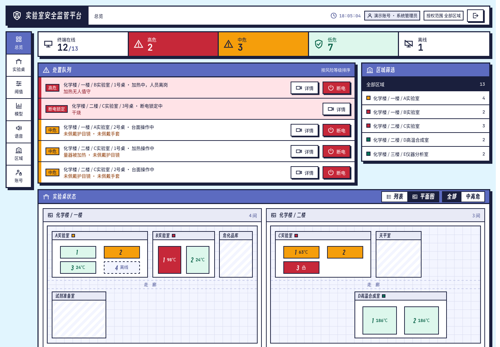

# 基于双摄协同的实验室安全事前干预监测系统

湖南涉外经济学院 3 队 · 第 22 届中国大学生计算机设计大赛 · 嵌入式赛道

在化学实验室里，用两个摄像头和几个传感器盯着实验台：人走了还在加热、烧杯快烧干、没戴护目镜、冒烟，**提前提醒**；真到危险时，由下位机**切断加热电源**，恢复供电只能到现场长按控制键。多间实验室的终端统一接入**总后台**，按楼层和房间查看每张实验桌。



| 实验台小屏 | 开发板本机控制台 |
| --- | --- |
|  |  |

## 系统组成

```
                 ┌──────────── 总后台（电脑 / 服务器，端口 8200）────────────┐
                 │ 账号与授权 · 楼层/房间/实验桌 · 平面图 · 阈值方案 · 远程断电 │
                 │ 画面与问答代理 · 模型看板 · 语音包 · 操作审计               │
                 └───────────────▲────────────────────────────────────────┘
                                 │ HTTP 上报快照 / 取回阈值、指令、语音包（断网不影响本机）
 ┌──────────── 每张实验桌一台开发板（RK3588，Python）────────────┐
 │ 两路摄像头 + YOLO11（NPU）→ 规则 R1–R9 · 交叉验证 · 温度预测   │
 │ 实验台小屏 · 本机控制台（端口 8180）· 安全助手                 │
 └───────────────▲──────────────────────────────────────────────┘
                 │ USB 串口（AA 55 帧，CRC16）：心跳、断电、语音、温湿度控制
 ┌──────────── ESP32-S3 控制盒 ────────────┐
 │ SHT30 / MLX90614 / MQ-2 · 继电器 · 控制键 │
 │ 本地硬规则：≥150℃ / 烟雾 ≥2500 / 失联 30 秒 → 断电 │
 └─────────────────────────────────────────┘
```

## 能做什么

**实验台（开发板）**
- **两路识别**：全景摄像头看人（在不在岗、护目镜 / 手套 / 实验服 / 口罩、饮食、伏案），台面摄像头看器皿（种类、是否靠近桌边）。YOLO11，开发板上用 NPU 推理（每帧约 120 ms）。
- **安全规则 R1–R9**：干烧、升温过快、加热时无人值守、烟雾、高湿、高温、量器被加热、预测即将烧干。
- **交叉验证**：人员 × 器皿 × 传感器综合打分，分低 / 中 / 高三级，每条依据附带处置动作，驱动信号灯和小屏的「待处理事项」。
- **分层上报**：同一次判断，学生端、实验室老师、实验楼各有一套等级。摘口罩吃东西这类行为违规只在实验台当场提醒学生（台词语音），实验室老师那边只记为知会；加热、温度、烟雾类风险才进老师的处置队列；实验楼只关心断电锁定和紧急事件。
- **台面安全区**：在网页上框选台面并标出危险边，器皿靠近或越过危险边时提醒。
- **温度预测**：沸点以下只预测多久沸腾；越过沸点还在升温，才给出干烧倒计时。只提醒，不参与断电。
- **安全助手**：警告和紧急事件自动生成处理建议，并引用安全手册条款。支持远程通义千问、本地 Ollama 和断网时的规则模板三条线路；助手只能看，不能控制任何设备。

**控制盒（ESP32-S3）**
- 断电指令执行后回复确认；本地硬规则和 30 秒失联保护独立于开发板，开发板死机也能断电。
- **控制键长按 2 秒**：通电中 = 现场断电并锁定；已断电 = 复位上电（先复查温度和烟雾，超标拒绝）。
- 排风扇和加湿片在本地闭环控制温湿度。

**总后台（多实验室管理）**
- **账号与授权**：管理员 / 教师两种角色，教师只能看、管被授权的楼栋、房间或单张实验桌。
- **总览**：处置队列按风险排序，按层级显示（管理员默认实验楼视角、教师默认实验室视角，可切换）；实验桌状态可切换「列表 / 平面图」，平面图按楼层 → 房间 → 实验桌显示，点实验桌进入详情。
- **实验桌详情**：两路实时画面（经总后台转发）、交叉验证依据、安全问答、远程断电（只能断电）。终端没有画面时可显示管理员上传的演示画面，并标明「演示画面」。
- **阈值方案**：按区域下发规则阈值，终端按本机控制盒的硬上限再校验，超限的项不生效并回报原因。
- **语音包**：每类提醒可配温和 / 严厉两种语气，下发到终端本机播放。
- 模型看板、操作审计、旧版像素风格（按账号切换）。

## 仓库结构

```
├─ labguard/     全部代码（运行、配置、固件、部署、测试都在这里）
├─ docs/         比赛文档、零基础上手指南、截图、开发记录
└─ slides/       答辩汇报 PPT
```

```
labguard/
├─ run_app.py            实验台终端入口（开发板 / 电脑）
├─ run_center.py         总后台入口
├─ config.yaml           终端的全部阈值和设置
├─ environment.yml       conda 环境（电脑和开发板共用，推荐）
├─ requirements.txt      pip 依赖（不用 conda 时）
├─ src/
│   ├─ core/             安全核心：规则、交叉验证、台面安全区、温度预测、事件、语音、接入总后台
│   ├─ agent/            安全助手
│   ├─ web/              开发板本机控制台（网页）
│   ├─ ui/               实验台小屏、电脑大窗口
│   └─ hardware/         传感器数据来源
├─ center/               总后台：接口、数据库、阈值预设、网页前端（原生 JS，无需构建）
├─ LabSafetyMonitor/     摄像头与识别、下位机串口协议
├─ models/               识别模型（.pt；*_rknn_model/ 为 NPU 模型）
├─ firmware/             ESP32-S3 控制盒固件
├─ deploy/orangepi/      开发板安装与开机自启（视美泰 AIOT-3588A、香橙派 5 通用）
├─ knowledge/            安全手册（安全助手检索用）
├─ fonts/                开源字体（得意黑、JetBrains Mono）
├─ tools/                总后台演示、串口调试、NPU 模型导出与检查、语音生成
└─ tests/                自动测试
```

## 快速开始

需要 Python 3.10–3.12，推荐用 conda。

```bash
cd labguard
conda env create -f environment.yml && conda activate lab_safety   # 或 pip install -r requirements.txt
python run_app.py                          # 电脑大窗口 + 本机控制台（网址和口令打印在终端里）
python run_app.py --mode edge --windowed   # 在电脑上看实验台小屏
```

本机控制台默认端口见 `config.yaml → web.port`（本仓库为 8180），端口被占用时自动顺延；口令也保存在 `runtime/web_token.txt`。

### 总后台

```bash
python run_center.py                       # http://127.0.0.1:8200
```

首次启动会创建 `admin` 账号，初始密码打印在终端并写入 `runtime/center_initial_password.txt`，首次登录必须改密。

**终端接入总后台**：在总后台「区域」页选中实验桌 → 登记终端，复制只显示一次的节点密钥，填到该开发板的 `config.yaml`：

```yaml
center:
  url: http://总后台的IP:8200
  node_token: 刚才复制的密钥          # 也可以用环境变量 LABGUARD_NODE_TOKEN
```

也可以用脚本一次建好（一张实验桌 + 一台终端 + 一个教师账号，不含任何模拟数据）：

```bash
python tools/center_init.py --center-url http://总后台的IP:8200 --password 教师密码
```

重启终端程序后，总览里这张桌会变为在线。总后台断开时终端照常判断和断电，恢复后自动重连。

### 演示（不需要开发板）

```bash
python tools/center_demo.py                         # http://127.0.0.1:8210，账号 demo / Demo2026show
python tools/center_demo.py --images 图片目录        # 批量设置各实验桌的演示画面
python tools/center_demo.py --live LG-A01           # 1 号桌留给真实终端，其余模拟
```

演示脚本自带一栋三层楼的示意布局和 13 台模拟终端（其中 1 台模拟离线）。加 `--live` 时会生成 `runtime/center_demo_live.yaml`，用它启动终端程序即可让 A 实验室 1 号桌显示真实摄像头画面：

```bash
LAB_SAFETY_CONFIG=runtime/center_demo_live.yaml python run_app.py --mode headless
```

### 安全助手接入大模型

安全助手默认线路是「远程 → 本地 → 规则模板」。不配大模型时只能用规则模板（按事件类型给固定建议并引用手册），回答末尾会标明。接通义千问：在开发板上

```bash
mkdir -p ~/.config/labguard && echo 'DASHSCOPE_API_KEY=你的Key' > ~/.config/labguard/env && chmod 600 ~/.config/labguard/env
```

开机自启的 `start.sh` 会加载这个文件（Key 不进仓库、不写配置文件）。在电脑上运行时直接 `export DASHSCOPE_API_KEY=...`。也可以在局域网电脑上装 Ollama，把 `config.yaml → agent.local.base_url` 改成那台电脑的地址。

没有摄像头和下位机时，本机控制台「参数」页可播放演示视频，「环境控制 → 演示数据」可注入干烧、烟雾等场景。

## 部署到开发板

```bash
git clone https://github.com/SSSSSmilewei/lab-safety-monitor.git
cd lab-safety-monitor/labguard
bash deploy/orangepi/setup.sh          # 系统依赖、串口与摄像头权限、conda 环境、NPU 运行库、开机自启
python tools/check_npu.py              # 检查 NPU：版本、模型加载、速度、和 .pt 结果对比
```

开机后 `deploy/orangepi/start.sh` 自动启动：接了屏幕用 edge 模式（小屏全屏 + 本机控制台），没接屏幕用 headless 模式。日志在 `runtime/app.log`。

## 烧录控制盒固件

本队板子为 ESP32-S3-N8R8，用 arduino-cli（esp32 核心 3.3.12）：

```bash
cd labguard
arduino-cli compile --fqbn esp32:esp32:esp32s3:FlashSize=8M,PartitionScheme=default_8MB,PSRAM=opi,CDCOnBoot=default \
    --output-dir firmware/build_s3_n8r8 firmware/lab_guard_esp32
arduino-cli upload --fqbn esp32:esp32:esp32s3:FlashSize=8M,PartitionScheme=default_8MB,PSRAM=opi,CDCOnBoot=default \
    -p /dev/ttyACM0 --input-dir firmware/build_s3_n8r8 firmware/lab_guard_esp32
```

继电器、蜂鸣器、控制键的触发电平在固件开头的 `RELAY_ACTIVE_HIGH` / `BUZZER_ACTIVE_HIGH` / `BTN_ACTIVE_HIGH` 里改。串口调试：`python tools/serial_probe.py`。

## 测试

```bash
cd labguard
python tests/test_backend.py    # 87 项：安全核心、规则、串口协议（仿真下位机）、控制键
python tests/test_platform.py   # 44 项：本机控制台接口、安全助手、安全约束检查
python tests/test_center.py     # 81 项：总后台、混合授权、终端经真实 HTTP 接入、平面图与演示画面、分层视角、呼叫教师
```

都不需要硬件和大模型，测试数据库建在临时目录，不会动 `runtime/`。

## 安全设计原则

- **软件只能断电，不能通电。** 本机控制台和总后台都没有通电 / 解锁接口，恢复供电只能到现场长按控制键，下位机复查温度和烟雾后才通电。测试会检查接口列表。
- **大模型不碰电闸。** 安全助手的工具全部只读；温度预测只提醒，不参与断电。
- **下位机本地规则独立于开发板运行**，是最后一道防线；网页上的断电阈值只能设在控制盒硬上限以下。
- **演示数据不和真实数据混用**：接上下位机后不能注入演示数据；总后台的演示画面会明确标出。
- **API Key 只放在环境变量里**，不写进配置文件，也不提交到仓库。

## 文档

- [零基础上手指南](docs/零基础上手指南.md)：给新队员看的入门文档，带截图和流程图
- [AGENTS.md](AGENTS.md)：给 AI 助手看的项目说明（接口、协议、引脚、当前状态）。把仓库交给 AI 提问时，让它先读这份文件
- [开发记录](docs/开发记录/)：代码审查、修改说明与落地计划（含采购清单）、评委视角审查
- 比赛提交的设计文档在 `docs/` 下（docx / pdf）

## 版本记录

| 标签 / 分支 | 内容 |
|---|---|
| `v1-prototype` | 最初上传的原型版本 |
| `v2-before-restructure` | 整理目录结构之前的完整版本 |
| `main` | 当前版本：实验台终端 + 控制盒 + 多实验室总后台 |

查看旧版本：`git checkout v1-prototype`；回到最新：`git checkout main`。
